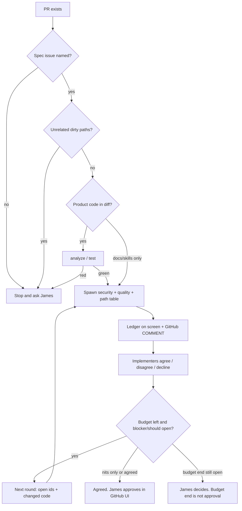

# PR review loop

Adversarial review. Root orchestrates. Reviewers never edit. Implementers
are the folder experts that wrote the code. James Hancock is the court.

Spec: GitHub issue named by the PR. Missing spec → stop and ask.

Lifted from ProjectFulcrum `fulcrum-pr-review-loop` (ADR 0044): unique
isolated subagents, ledger, COMMENT reviews, no Copilot reviewer corps.

## Decision tree (every round)

1. **No PR** → stop; need a PR number/URL.
2. **No spec issue** in PR body/closing keywords → stop; ask James.
3. **Unrelated dirty paths** in the worktree → stop; ask.
4. **Mechanical gate** (product Dart/C#/JS in the diff): `dart analyze`
   / `flutter test` / `dotnet test` on the touched package must be green
   before round 1. Pre-failing checks go in the brief; do not send code
   this change breaks.
5. **Who spins** (parallel, isolated, no shared history):

   Always spawn `rdg-review-security`.

   Quality: no language row below (docs/skills-only) → one quality at
   repo root. Each matching language row → one quality spawn with that
   addendum and cwd. Mixed stacks spawn one quality per matching
   language row. Do not also spawn a leftover root quality.

   | Diff contains | Spawn |
   | --- | --- |
   | `responsive_data_grid/**` `.dart` | quality + Dart addendum; cwd `responsive_data_grid` |
   | `client_filtering/**` `.dart` | quality + Dart addendum; cwd `client_filtering` |
   | `dotnet/**` `.cs` | quality + C# addendum; cwd `dotnet` |
   | `javascript/**` `.ts` | quality + TypeScript addendum; cwd `javascript` |

6. **Severity (orchestrator re-labels; reviewer labels are claims):**
   - **blocker** — intended case wrong, or exploitable security /
     identity disclosure.
   - **should** — callers will hit it; AGENTS/skill/analyzer/**new
     warning**; James-shape slop. Linter warnings and slop are should.
   - **nit** — taste, rare path, extra compat, small perf,
     comment/format-only. Decline. No extra round.
7. **Coverage** — changed production executable lines **90%+** unless
   implementers evidence why more is not required. Docs/skills-only: N/A
   with one-line evidence.
8. **Budget** — 3 rounds. Extend to 5 only while a **security**
   blocker/should stays open with evidence, or James asks. Stop early on
   nits-only. Budget end is not approval.
9. **Copilot code review** starts when `@copilot` /
   `copilot-pull-request-reviewer[bot]` is a requested reviewer. Do not
   assign it (`gh pr edit --add-reviewer "@copilot"`,
   `request_copilot_review`, GraphQL `requestReviewsByLogin` with
   `botLogins: ["copilot-pull-request-reviewer"]`). If it is already
   requested, remove it in Pin. Leave Copilot SWE (`@copilot` in a
   comment) alone.



## Round

Do not edit scoped files while reviewers run.

### 1. Pin

```bash
gh pr view <n> --json number,title,body,headRefOid,baseRefName,url,files,reviewRequests
git fetch origin
# HEAD must be the PR head. Wrong tree → stop; checkout / worktree.
test "$(git rev-parse HEAD)" = "<headRefOid>"
BASE=$(git merge-base HEAD origin/<baseRefName>)
# Copilot code review runs only while assigned. Drop it if present.
gh api -X DELETE "repos/$(gh repo view --json nameWithOwner -q .nameWithOwner)/pulls/<n>/requested_reviewers" \
  -f 'reviewers[]=copilot-pull-request-reviewer[bot]' || true
```

Spec: closing `#N` / `Closes #N` / a `Spec: #N` line in the PR body.
`gh issue view <N>`. Empty body → stop.

Intent + out of scope: 1–2 sentences. One diff command all rounds:
`git -c color.ui=false -c color.diff=false diff <BASE>...HEAD`.

### 2. Spawn reviewers

`spawn_subagent`, `background: true`, then wait. First prompt line is the
persona (`You are rdg-review-security` / `You are rdg-review-quality`).
CWD from the table. Brief is **only**:

- persona + “read your skill, then the disclosed playbook it names”
- PR URL, SHAs, spec issue number (`gh issue view`)
- diff command + path list
- round k / budget, open ledger ids (later rounds: those ids + changed
  code only)
- “Do not edit, commit, push, comment on PRs, or spawn reviewers.”

Do not paste AGENTS.md or the implementation chat.

If this PR edits a reviewer playbook, `AGENTS.md` review routing, or the
quality gate, reviewers still apply HEAD's catalog to product files and
treat catalog weakenings vs BASE as their own findings.

### 3. Ledger + screen + GitHub

Parse each reviewer into the ledger format in
[ledger.md](ledger.md). Show the ledger on screen. Post a **COMMENT**
review with inline comments (right-side lines) the same round. Procedure
in ledger.md.

### 4. Answer findings

Spawn the **same** folder experts (`resume_from` if this session; else
fresh with spec + ledger only). Root implements only root-owned paths.

For each id the implementer:

- **Agree** — smallest fix. Prefer delete. One focused test if the spec
  needs it.
- **Disagree** — why, with file:line / test / output.
- **Nit / out of scope** — decline one line; follow-up list.

Do not agree just to end the loop. Re-run the mechanical gate. If the
diff grew, cut first.

### 5. Next round or stop

Start another round only if budget remains **and** a blocker/should is
open **and** behavior code changed or approval does not cover the current
diff. Reviewer rebuttal: once per still-open blocker/should.

**Stuck** (James decides): item disputed after two replies, or “is this
slop?”, or budget ends. Show both sides in 2–3 lines each.

**Agreed:** reviewers APPROVE the current behavior diff, no
blocker/should open, no concern of your own.

Do not push during the loop. Push after agreement only if James asked to
push or update the PR. Merge only when James asked to merge.

## Report

Rounds, who spun, diff size before/after, fixed / declined / disputed
ids with reasons, GitHub review ids, pushed or not.
