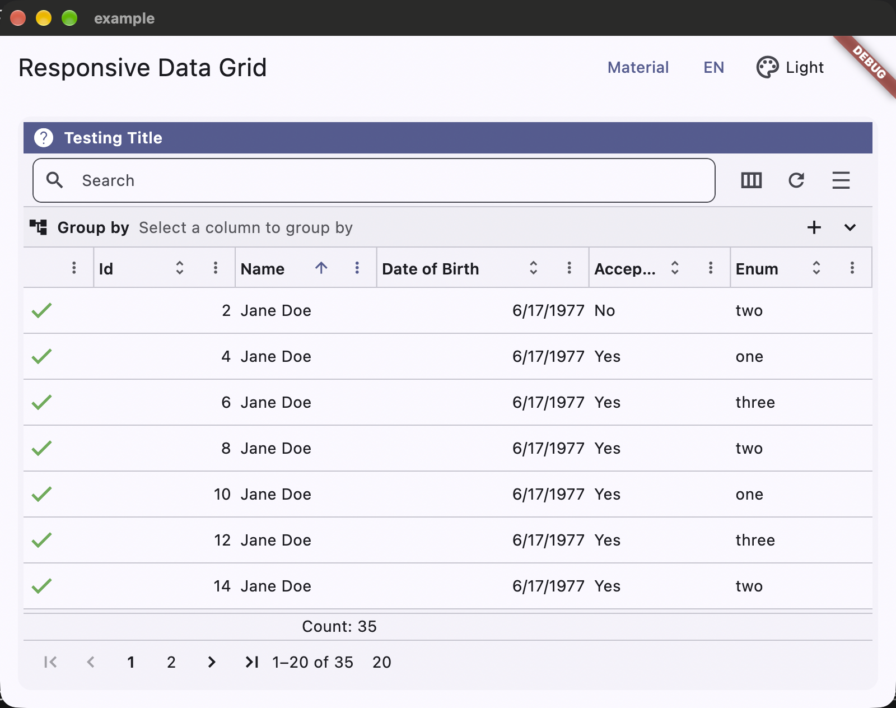
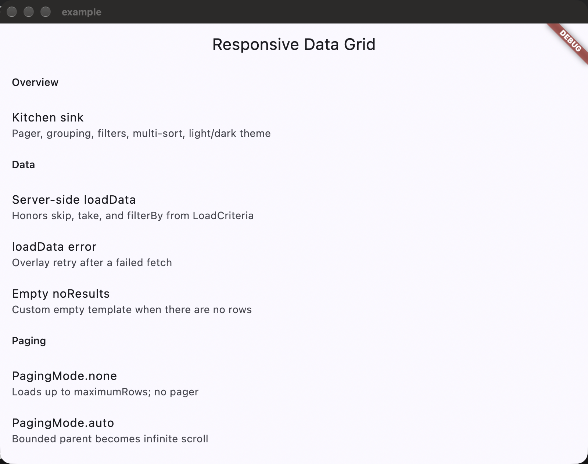

# responsive_data_grid

[](https://github.com/4D-Technologies/responsive_data_grid/actions/workflows/ci.yml)
[](https://pub.dev/packages/responsive_data_grid)

A Flutter data grid inspired by Kendo UI Grid: paging, sorting, filtering, grouping, and a bootstrap-style 12-column layout.

Companion backends: `client_filtering` (Dart), the `dotnet/` folder (NuGet), and `javascript/` (TypeScript). All three speak the same `LoadCriteria` JSON.

## Features

- Client-side (`items`) and server-side (`loadData`) constructors
- Paging: `pager`, `infiniteScroll`, `none`, and `auto`
- Single- and multi-column sort, menu and row filters, grouping with group footers
- Aggregates, column visibility, freeze, sticky columns, resize, reorder
- `GridSizing.fill` / `shrinkWrap` / `auto` for tabbed pages and infinite min/max height
- `ResponsiveDataGridTheme` under `MaterialApp` and `CupertinoApp`
- English and Spanish `GridLocalizations`

## Install

```yaml
dependencies:
  responsive_data_grid: ^1.1.0
  client_filtering: ^0.0.29
```

Add `GridLocalizations.delegate` next to the Flutter delegates.

```dart
MaterialApp(
  localizationsDelegates: [
    GridLocalizations.delegate,
    ...GlobalMaterialLocalizations.delegates,
  ],
  supportedLocales: GridLocalizations.supportedLocales,
  home: const MyGridPage(),
);
```

## Getting started

Always specify the row generic: `ResponsiveDataGrid<Order>`.

### Client-side

```dart
ResponsiveDataGrid<Order>.clientSide(
  items: orders,
  pageSize: 20,
  pagingMode: PagingMode.pager,
  columns: [
    IntColumn(
      fieldName: 'id',
      header: const ColumnHeader(text: 'Id', showFilter: true, showOrderBy: true),
      value: (row) => row.id,
      xsCols: 2,
    ),
    StringColumn(
      fieldName: 'name',
      header: const ColumnHeader(text: 'Name', showFilter: true, showOrderBy: true),
      value: (row) => row.name,
      xsCols: 10,
    ),
  ],
);
```

### Server-side `LoadCriteria` contract

`loadData` receives a `LoadCriteria` and must return a `ListResponse<T>` (or `null`). Honor `skip` / `take` for paging. Filters, sorts, groups, and aggregates arrive as lists you can send to your API as JSON or OData (`criteria.filterBy.toOdata()`).

```dart
ResponsiveDataGrid<Order>.serverSide(
  pagingMode: PagingMode.pager,
  pageSize: 25,
  loadData: (criteria) async {
    final page = await api.fetchOrders(
      skip: criteria.skip ?? 0,
      take: criteria.take ?? 25,
      filter: criteria.filterBy,
      orderBy: criteria.orderBy,
      groupBy: criteria.groupBy,
      aggregates: criteria.aggregates,
    );
    return ListResponse<Order>(
      totalCount: page.totalCount,
      items: page.items,
      groups: page.groups,
      aggregates: page.aggregates,
    );
  },
  columns: [ /* same column list */ ],
);
```

`PagingMode.none` sends `take: maximumRows` (default 99999) and omits the pager. On failure, the grid keeps its height, shows a retry overlay, and calls `onLoadError`.

## Paging

| Mode | Behavior |
| --- | --- |
| `pager` | One page of `pageSize` rows plus a pager |
| `infiniteScroll` | Loads the next page as the user scrolls. Needs a bounded height, or set `minHeight` / `maxHeight` |
| `none` | Loads up to `maximumRows` in one request |
| `auto` | Infinite scroll when the host height is bounded (including an explicit `height`); pager when the parent is a scroll view. `GridSizing.fill` and `shrinkWrap` force pager |

## Height and scrolling

- `GridSizing.auto` (default): `height` if set, otherwise fill a bounded parent or shrink-wrap in a scroll view
- `GridSizing.fill`: never shorter than one page of rows plus header, filter row, groups, footers, and pager. A taller parent is filled. A short tight parent keeps an inner body scrollbar. An unbounded parent (tab `ListView`) uses that minimum so the **host** scrolls
- `GridSizing.shrinkWrap`: size to the current page; the host scrolls
- Infinite scroll clamps the **entire** grid between `minHeight` and `maxHeight`, including inside an unbounded parent

`ResponsiveDataGridState.minimumHeight` is the computed floor.

## Grouping and infinite scroll

Grouped pager bodies pin the current group header while its rows scroll. Infinite scroll keeps group headers, nested groups, and group footers. Client-side grouped infinite scroll pages **groups**, not raw rows. A server `loadData` should return the same shape: `ListResponse.groups` for the requested `skip`/`take` of groups.

Row pin, sticky rows, and row reorder apply to the ungrouped pager only.

## Theming

```dart
ThemeData(
  useMaterial3: true,
  colorScheme: ColorScheme.fromSeed(seedColor: Colors.teal),
  extensions: [
    ResponsiveDataGridTheme.fromTheme(
      ThemeData(colorScheme: ColorScheme.fromSeed(seedColor: Colors.teal)),
    ),
  ],
);
```

`fromCupertino` does the same under `CupertinoApp`. Override individual tokens (header colors, pager icons, footer padding) on the extension. Empty grids show themed "No records available." chrome; `noResults` replaces that template.

The example app switches Light / Dark / Branded palettes from the kitchen-sink app bar.

## Screenshots



Kitchen sink: grouping, filters, multi-column sort, toolbar, and pager.



Example catalog. Jump to a screen with `--dart-define=DEMO_SCREEN=<id>`.

## Example app

```
cd responsive_data_grid/example
flutter run
```

The home catalog is grouped into Overview, Data, Paging, Height, and Columns. Jump to a screen with `--dart-define=DEMO_SCREEN=<id>` (see `example/README.md`).

## Additional packages

For a C# WebAPI that turns `LoadCriteria` into a LINQ / Entity Framework expression tree, see the `dotnet/` folder. TypeScript lives in `javascript/`.
